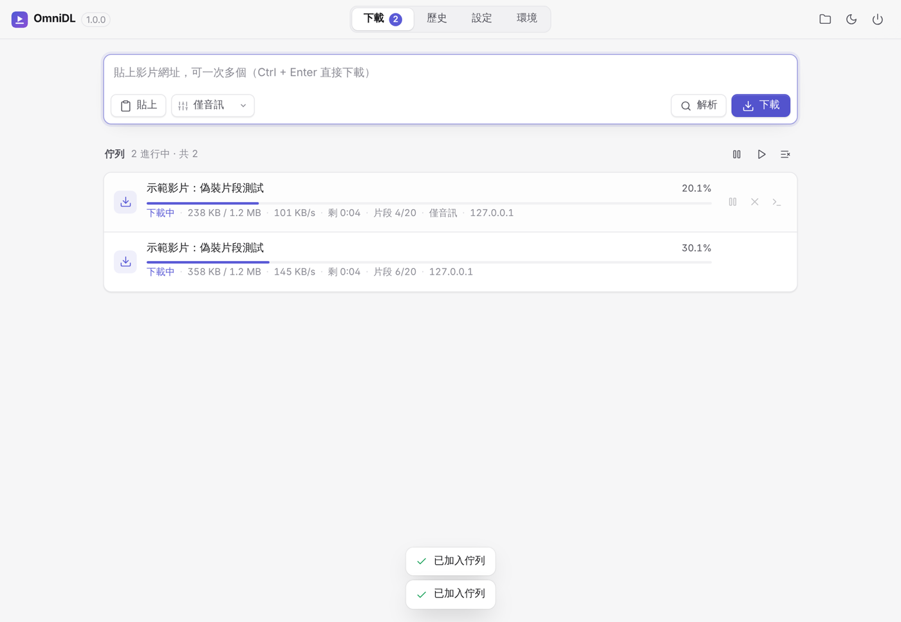
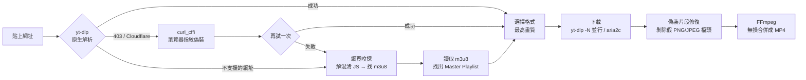
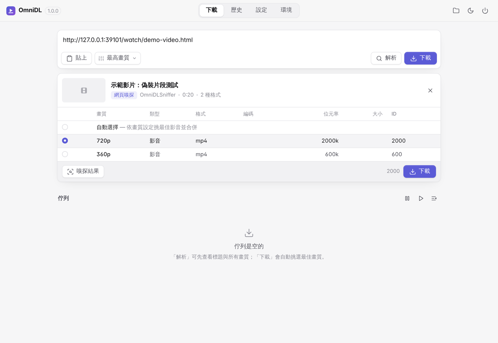
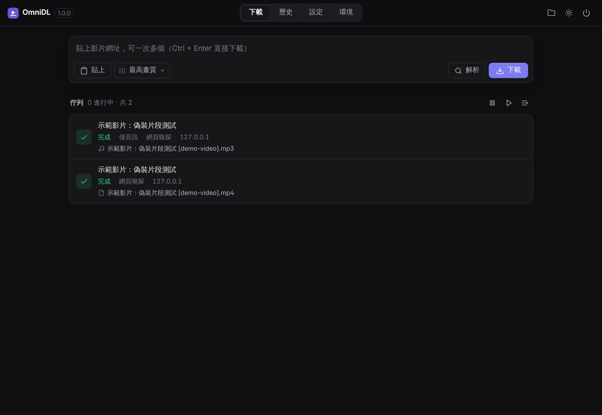
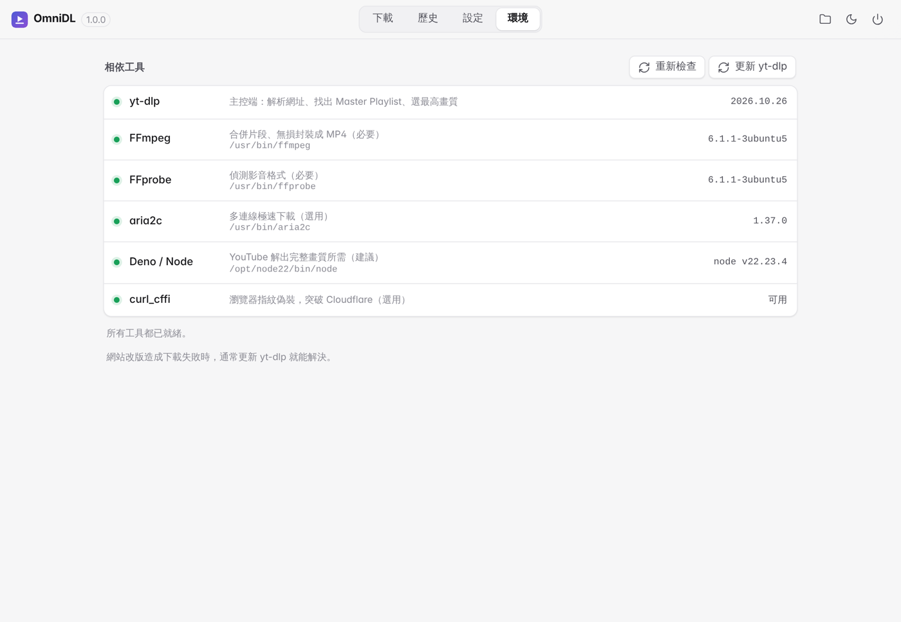
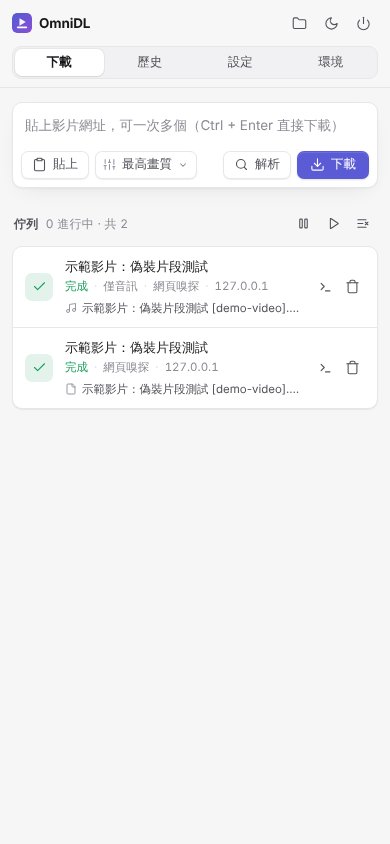

<div align="center">


# OmniDL 萬用影片下載器

**yt-dlp 智慧解析 × FFmpeg 無損合併 × aria2c 極速下載**<br>
外加網頁嗅探、偽裝片段修復、Cloudflare 指紋偽裝的一站式影片下載工具

[](https://github.com/rio10255254/OmniDL/actions/workflows/ci.yml)


</div>

<p align="center"></p>

## ✨ 特色

| | 功能 | 說明 |
|---|---|---|
| 🧠 | **智慧解析** | 由 yt-dlp 支援 YouTube、Bilibili、X/Twitter、Instagram、TikTok 等數千個網站，自動找出 Master Playlist 並挑最高畫質 |
| 🕵️ | **網頁嗅探備援** | yt-dlp 不認得的網站，自動抓網頁原始碼找出藏起來的 `.m3u8 / .mpd / .mp4`，可解開 `eval(function(p,a,c,k,e,d)…)` 混淆 JS、`\/` 跳脫與 Base64，並實際讀取 m3u8 判斷哪個才是「總菜單」 |
| 🩹 | **偽裝片段修復** | 有些網站把 TS 片段改名成 `.jpeg/.png`，甚至在每段前面塞假圖片檔頭，導致合併後檔案壞掉。OmniDL 會逐一對齊 188-byte TS 封包，剝除所有垃圾位元組後再交給 FFmpeg 無損合併 |
| 🛡️ | **自動突破防護** | 遇到 403 / Cloudflare 時自動以 curl_cffi 偽裝瀏覽器 TLS 指紋重試；需登入的影片可直接讀取瀏覽器 Cookies |
| ⚡ | **雙引擎加速** | 內建 HLS 下載器多片段並行（`-N 8`），大型直連檔可切換 aria2c 16 連線榨乾頻寬 |
| ⏯️ | **佇列與續傳** | 多工同時下載、暫停 / 繼續（斷點續傳）、取消時自動清除暫存，關掉程式下次開啟仍可續傳 |
| 🎧 | **格式自由** | 指定畫質上限（4K～360p）、僅音訊（mp3 / m4a / opus / flac）、MP4 / MKV、字幕、縮圖與章節嵌入 |
| 🧰 | **零設定** | Windows 首次啟動自動下載 FFmpeg / aria2c / Deno；內建 yt-dlp 一鍵更新（連打包版 exe 都能更新） |

## 🧩 架構



| 元件 | 角色 |
|---|---|
| **yt-dlp** | 大腦：解析網址、找 Master Playlist、選畫質、原生 HLS 多執行緒下載與續傳 |
| **FFmpeg** | 加工廠：把片段無損合併 / 封裝成 `.mp4`，音訊轉檔，嵌入字幕與縮圖 |
| **aria2c** | 超級引擎（選用）：多連線激進下載，只負責搬檔案 |
| **Deno / Node** | 讓 yt-dlp 解出 YouTube 完整畫質（建議安裝） |
| **curl_cffi** | 偽裝瀏覽器 TLS 指紋，突破 Cloudflare |

## 📦 安裝

### Windows（推薦）

1. 到 [Releases](https://github.com/rio10255254/OmniDL/releases) 下載 `OmniDL-windows-x64.zip`
2. 解壓縮後執行 `OmniDL.exe`
3. 第一次啟動會自動下載 FFmpeg、aria2c、Deno，完成後就能開始下載

> 獨立視窗需要 Microsoft Edge WebView2（Windows 10/11 已內建）；若無法開啟視窗會改用預設瀏覽器。

### 從原始碼執行（Windows / macOS / Linux）

需要 Python 3.10 以上。

```bash
git clone https://github.com/rio10255254/OmniDL.git
```

```bash
cd OmniDL
```

Windows 直接雙擊 `scripts\run_windows.bat`，macOS / Linux 執行：

```bash
./scripts/run.sh
```

或手動安裝：

```bash
pip install -e ".[desktop]"
```

```bash
omnidl
```

macOS / Linux 請自行安裝 FFmpeg（必要）與 aria2、Deno（選用）：

```bash
brew install ffmpeg aria2 deno            # macOS
```

```bash
sudo apt install ffmpeg aria2             # Debian / Ubuntu
```

## 🖥️ 使用方式

### 圖形介面

```bash
omnidl              # 開啟介面（預設在瀏覽器，加 --window 用獨立視窗）
```

- **下載**：貼上網址（可一次多個），按「下載」自動挑最高畫質；按「解析」可先看標題、所有畫質、播放清單內容並自行挑選
- **嗅探結果**：在解析面板中可看到網頁裡所有串流候選，手動指定要下載哪一個
- **佇列**：滑過項目可暫停 / 繼續 / 取消 / 查看詳細紀錄；點檔名直接在資料夾中顯示
- **設定**：所有選項自動儲存
- **環境**：檢查工具狀態、一鍵安裝 / 更新

<table>
<tr>
<td></td>
<td></td>
</tr>
<tr>
<td></td>
<td align="center"></td>
</tr>
</table>

### 命令列

```bash
omnidl get "https://www.youtube.com/watch?v=xxxx"              # 最高畫質
omnidl get URL -q 1080                                        # 畫質上限 1080p
omnidl get URL -q audio -a mp3                                # 只要 mp3
omnidl get URL -N 16 --aria2 http                             # 加速
omnidl get URL --cookies-from-browser firefox                 # 需要登入的影片
omnidl get -i urls.txt -o D:\Videos                           # 批次下載
omnidl info URL                                               # 列出所有畫質
omnidl sniff URL                                              # 只嗅探網頁中的串流網址
omnidl doctor                                                 # 檢查 FFmpeg / aria2c / yt-dlp
omnidl update                                                 # 更新 yt-dlp
```

`omnidl URL` 等同 `omnidl get URL`。中斷後再執行同一指令即可續傳。

## ❓ 常見問題

<details>
<summary><b>下載失敗，顯示「Sign in to confirm you're not a bot」或需要登入</b></summary>

到「設定 → 瀏覽器 Cookies」選擇你平常登入該網站的瀏覽器（Chrome 開著時可能讀不到，建議用 Firefox，或先關閉 Chrome）。
</details>

<details>
<summary><b>以前能下載的網站突然不行了</b></summary>

網站改版是常態，到「環境」頁按「更新 yt-dlp」，重新啟動即可。打包版 exe 也能更新（新版 yt-dlp 會放在使用者資料夾並優先載入）。
</details>

<details>
<summary><b>網站不在 yt-dlp 支援清單裡</b></summary>

預設會自動嗅探；若 yt-dlp 抓到的是錯的影片（例如預告片），可在「設定 → 網頁嗅探」改成「一律優先」，或在解析面板按「嗅探結果」手動選擇。
</details>

<details>
<summary><b>aria2c 要開嗎？</b></summary>

HLS（m3u8）串流用內建下載器搭配「片段並行數」8–16 通常最快也最穩；aria2c 對「一個很大的 MP4 直連檔」效果最明顯，建議選「僅一般直連檔」。
</details>

<details>
<summary><b>資料存在哪裡？</b></summary>

設定、歷史、工具程式放在 `%APPDATA%\OmniDL`（Windows）、`~/Library/Application Support/OmniDL`（macOS）、`~/.config/omnidl`（Linux）。可用環境變數 `OMNIDL_HOME` 指定其他位置。
</details>

## 🛠️ 開發

```bash
pip install -e ".[dev]"
```

```bash
pytest -q
```

測試會在本機架一個「模擬網站」：影片網址藏在 p,a,c,k,e,d 混淆 JS 裡、有兩種畫質的 Master Playlist、每個片段偽裝成 `.jpg` 並塞了真的 PNG 檔頭、m3u8 需要 Referer 才能讀取——完整驗證 嗅探 → 選畫質 → 下載 → 修復 → 合併 的流程，以及暫停 / 續傳 / 取消、aria2c、僅音訊等功能。

**自動發布：** 把 `omnidl/__init__.py` 的 `__version__` 改成新版本並推到 `main`，GitHub Actions 就會自動打包 Windows exe、建立 `v<版本號>` 標籤並發布到 Releases（同一版本只會發布一次）。

```python
__version__ = '1.1.0'
```

```
omnidl/
├── engine.py     下載引擎：yt-dlp 參數、備援鏈、進度回報
├── sniffer.py    網頁嗅探：解混淆、找串流、判斷 Master Playlist
├── tsrepair.py   偽裝片段修復：TS 封包重新對齊
├── jobs.py       佇列：排程、暫停 / 續傳 / 取消、歷史
├── server.py     本機 API（只監聽 127.0.0.1，含 token 防跨站）
├── tools.py      FFmpeg / aria2c / Deno 偵測與安裝、yt-dlp 更新
├── cli.py        命令列
└── web/          介面（HTML / CSS / JS，無需建置）
```

## ⚖️ 聲明

本工具僅供下載你**有權保存**的內容（自己上傳的影片、創用 CC 授權內容、網站允許下載的內容等）。請遵守各網站服務條款與當地著作權法。本工具**不支援**也不會嘗試破解 DRM（Widevine / PlayReady / FairPlay）保護的串流。

FFmpeg、aria2、Deno 均於執行時從其官方發行處下載，各自依其授權條款（GPL / LGPL / MIT）散布。

MIT License
